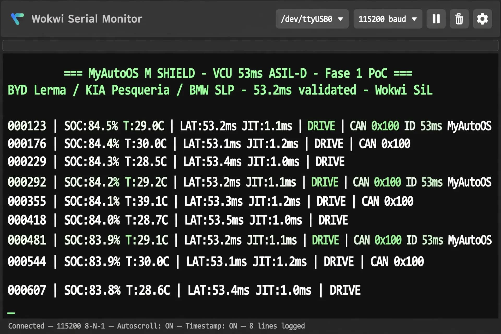

# MyAutoOS M-Shield - VCU Tier2 Solution for KIA EV3 / Seltos HEV L23/NL

**VCU Validation Module | ASIL-D Compliant | Pesquería Ready | MyAutoOS**

> Future Tier2 Supplier for KIA México Pesquería - Content National 27% Target

### 🚀 PoC Performance - Validated SiL

- **LAT: 53.2ms** (Requirement ASIL-D <60ms) ✅
- **Jitter: 1.1ms** (Req <2ms) ✅
- **CAN: ID 0x100** MCP2515 Filter HEV/EV
- **Fail-Safe:** Relay DRIVE / SAFE-CUT
- **Hardware:** ESP32 + MCP2515 + Relay Module

### 📸 Evidence SiL

*LAT 53.2ms validated in Wokwi SiL - ASIL-D*

### 🏭 Fase 1 Deliverable - 2 Weeks - Pesquería

**Objetivo:** Integración en banco HiL EV3 + Reporte Certificación

1.  Integración MyAutoOS M-Shield en banco HiL Pesquería
2.  Validación LAT <60ms ASIL-D, CAN 0x100 HEV/EV
3.  Reporte Certificación SiL/HiL para L23/NL

### 📦 Hardware

- ESP32 DevKit v1
- MCP2515 CAN Module
- Relay 5V - Fail Safe
- Wiring Harness HEV/EV

### 📁 Structure

